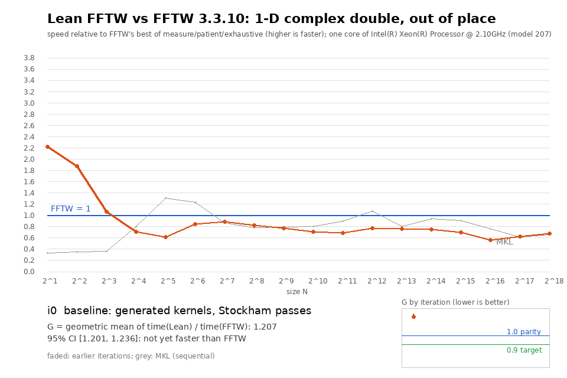

# Lean FFTW

A double-precision FFT library written in Lean 4, with kernel-checked proofs that what it
computes is the discrete Fourier transform. FFTW 3.3.10 is the benchmark competitor and the
source of the test harness; Lean FFTW never links or calls it.



## Results

* **Speed.** On the predeclared benchFFT workload (1-D complex, out of place, N = 2…2^18,
  one core), Lean FFTW takes **0.75–0.83×** the time of FFTW's best planner mode per size,
  as a geometric mean over the 18 sizes. The repo's run gave 0.750 (95% CI [0.744, 0.765],
  Sapphire Rapids, 2026-10-31). An independent rerun on a fresh VM of the same CPU model, with
  FFTW rebuilt and its wisdom regenerated, gave **0.828 (CI [0.815, 0.853])**
  ([docs/REPRODUCTION.md](docs/REPRODUCTION.md)). Both meet the predeclared target of ≤ 0.90.
  **The margin comes from small sizes:** about 0.5× for N ≤ 16 in both runs. From N = 256 up,
  the two libraries are at parity. The repo's run had Lean FFTW ahead for N ≥ 1024 (0.93).
  The rerun did not reproduce that: it had Lean FFTW behind (1.03), slower at every size from
  4096 to 2^18 by 2–9%. A second, libbench2-free harness put the same sizes at 0.94–0.97. **Sizes whose prime
  factors are at most 13** run in the fast engine too, with proved radix-3–15 kernels. On the
  repo's seven secondary sizes (N = 6 … 10368) Lean FFTW is at parity with FFTW: 0.97
  (CI [0.95, 1.04]) in the repo's run, 0.99 in the rerun. Over all 18 benchFFT 13-smooth sizes
  (up to 165375) the rerun gives 1.04 (CI [1.03, 1.09]). Per size this ranges from 0.5× at
  N = 6 to 1.7× at N = 75600. Planning, which is not counted, is far slower than FFTW's: Lean
  FFTW measures every candidate plan and has no wisdom. In the repo's run MKL was slower than
  both (MKL was not part of the rerun). Details: [docs/RESULTS.md](docs/RESULTS.md).
  On a third CPU (Granite Rapids, 2026-11-07, FFTW wisdom regenerated) the current commit
  gives **0.814 (CI [0.794, 0.829])**, again all from small sizes; there FFTW is ahead from
  N = 512 up, by 1.3× at the two largest sizes.
* **Accuracy.** libbench2's multiple-precision check gives an L2 error within 1.08× of
  FFTW's at every primary size and 1.11× at the secondary sizes (rerun: within 1.04×).
* **Tests.** FFTW's own harness (libbench2 `--verify` driven by `tests/check.pl`) passes
  over FFTW's double-precision guru surface: complex, r2c/c2r and all 11 r2r kinds, any
  rank, vector rank and strides, in and out of place, split or interleaved. That covers
  all 50,702 problems of FFTW's exhaustive bigcheck enumeration (`check.pl -a`). See
  [docs/FFTW_INVENTORY.md](docs/FFTW_INVENTORY.md) for everything FFTW has and what is not
  covered (other precisions, threads, MPI, wisdom, the `fftw3.h` C API). The full enumeration
  was last run with the C engine; it has not yet been rerun on the assembly engine, which
  passes `--verify` on the 29 problems tried.
* **Proofs.** No `sorry`, no new axioms ([scripts/Axioms.lean](scripts/Axioms.lean)):
  * the spec agrees with Mathlib's `ZMod.dft`;
  * the generated butterfly kernels and the Stockham schedule compute the DFT exactly;
  * the executable binary64 reference is within an explicit bound of the exact DFT,
    through FloatLib's IEEE model. Evaluated for the benchmark plans, the bound is valid but
    loose: 18× above the observed error at N = 4, and up to about 10⁵× at the largest sizes.
    The twiddle (τ) and constant (κ) accuracies it assumes were measured at 0.502 ulp and
    0.945 ulp ([docs/REPRODUCTION.md](docs/REPRODUCTION.md));
  * the in-place schedule the fast engine runs equals the Stockham schedule for every
    arithmetic, and the Lean-compiled backend equals the binary64 reference;
  * the checker that accepts every block of emitted vector code is sound: an accepted block
    computes its specification on every machine state (`check_sound`);
  * the planner's operation counts are the query costs of a CSLib program that is also
    proved to compute the DFT;
  * every block of emitted code has a lower bound on its running time, proved for every
    schedule of its micro-operations on the ports of the processor model
    (`block_cycles_ge`); measured passes run 5 to 20% above it;
  * optimizations are proved too: the generator's rewrites (FMA contraction,
    tan-factored twiddle rotations) and its algorithms for radices that are not powers
    of two (paired odd-length DFTs, factored mixed radix, the Good–Thomas prime factor
    algorithm) are covered by the kernel theorem, and the generic engine's compiled
    code is a `@[csimp]` replacement proved equal to its specification.

  Details: [docs/THEOREMS.md](docs/THEOREMS.md).
  The cost of the emitted code, proved and measured: [docs/COST_MODEL.md](docs/COST_MODEL.md).

## No C in the library: Lean writes the machine code

Since 2026-11-10 the library contains no C. The fast engine is x86-64 AVX-512 assembly that
Lean writes itself (`LeanFFTW/Asm`): an instruction DSL, a vectorizer and a register
allocator in Lean produce GNU assembler text, and `as` is the only external tool between
Lean and the machine code. Planning, twiddle tables, address tables and the executor's
plan tree are Lean as well. The earlier engine (600 lines of hand-written C around 193,000
lines of C kernels printed by Lean, compiled by gcc) was removed once the assembly engine was
at least as fast at every size measured; it is in the history up to commit `7cc9489`.

Nothing in the vectorizer, scheduler or register allocator is trusted. Every block of vector
code they emit is checked against a specification derived from the proved kernels, by a
checker whose soundness is a theorem (`check_sound`): an accepted block computes its
specification on every machine state, in exact arithmetic and in binary64. The generator
refuses to write a block that fails. This has already paid for itself: the checker caught a
register-allocator bug (a spill slot released one instruction early) that no test had hit.

The code is about 12,700 lines of hand-written Lean. The only C left in the repository is
the 626-line adapter that plugs the library into FFTW's benchmark and test program
(`bench/backends`). For comparison, FFTW's generator is OCaml and its runtime is C, at
roughly 1 line of OCaml to 5 of hand-written C.

`LeanFFTW.Native` is a second backend, compiled by Lean's own compiler over unboxed
`FloatArray`, proved to compute `refTransform`; it is 1.6–2.9× slower than SIMD code from
N = 1024 up ([docs/LEAN_DRIVEN.md](docs/LEAN_DRIVEN.md)).

**Speed of the assembly engine.** The protocol figures under Results were measured with the
C engine. Quick measurements of the assembly engine on Emerald Rapids (one core, FFTW in
patient mode, not yet the full protocol): at commit `79069f3`, geometric mean about 0.78×
FFTW's time over the powers of two, with FFTW still 3–7% ahead at N = 256, 512 and 2^17, and
0.49–0.91× for the composite sizes from 18 to 240. Since then the powers of two from 16 to
2^18 became 7% faster on geometric mean ([docs/COST_MODEL.md](docs/COST_MODEL.md)), and the
in-place schedule now covers sizes that are not powers of two: ten such sizes from 360 to
50000 run at 0.73–1.04× FFTW's time, geometric mean 0.89 (before: 0.71–1.50×, geometric mean
1.07; N = 50000 went from 1.50× to 1.04×). With threads (4 virtual CPUs, FFTW patient built
with `--enable-threads`, N = 4096 to 2^18): 0.52–0.72× FFTW's time at 2 threads and
0.28–0.77× at 4; the engine itself gains 2.6–2.9× from 1 to 4 threads at 2^16 and 2^18 and
under 1.2× at 16384 and below. The numbers are in `results/emr-quick`. A protocol run with
confidence intervals is still to come.

## How the pieces fit

```
Lean spec (dftSum = Mathlib ZMod.dft)
   │ proved
Lean codelet generator ── butterflyK kernels ── Stockham schedule (stockhamWith)
   │ proved: exact DFT; binary64 error bound for refTransform
   │ instantiated lane by lane as the specification of every vector block
Lean vectorizer, scheduler, register allocator ── AVX-512 instructions
   │ each block checked by a checker proved sound (check_sound)
   │ printed as assembler text, assembled by `as`
assembly engine (1-D complex, prime factors ≤ 13), plans built and run from Lean
   │ tested bit for bit against refTransform
libbench2 / check.pl (FFTW's harness)
```

Everything outside the fast engine runs in the generic engine, which is pure Lean. Its
algorithm is proved correct in exact arithmetic, and the fast code the compiler runs for
it is proved equal to that algorithm (`@[csimp]`), but its floating-point error is not
analysed. [docs/TRUST.md](docs/TRUST.md) lists every link and how it is established.

## Layout

| Path | Contents |
|---|---|
| `LeanFFTW/Spec` | the DFT specification |
| `LeanFFTW/Gen` | codelet generator (symbolic DFT, simplifier, CSE, operation counts) |
| `LeanFFTW/Asm` | the assembly engine: instruction DSL, vector IR, register allocator, checker and its soundness proof, kernels and schedules, plans, planner |
| `LeanFFTW/Core` | generic engine (mixed radix, r2c/c2r, r2r, guru problems), twiddles |
| `LeanFFTW/Native` | the Lean-compiled backend (generated kernels, executor, unsafe primitives) |
| `LeanFFTW/Proof` | correctness and floating-point proofs |
| `scripts` | build script, the assembly writer (`gen_asm`), tests (`asm_test`), axiom audit |
| `bench/backends` | libbench2 adapters (Lean FFTW, MKL): the only C in the repository |
| `tools` | protocol runner and analysis, accuracy, bigcheck, GIF |
| `results` | raw and analysed benchmark data |
| `docs` | contract, FFTW inventory, protocol, iteration log, results, theorems, trust |

## Building

Requirements: Lean 4.35.0 (`lean-toolchain`), the Mathlib, CSLib and FloatLib revisions in
`lake-manifest.json`, GNU `as`, and an x86-64 CPU with AVX-512 (F, DQ and VL) for the fast
engine. A C compiler is needed only by Lean's own tool chain and for the benchmark adapter.

```sh
lake build                                   # library and proofs
lake env lean scripts/Axioms.lean            # axiom audit
LEAN=<lean-4.35.0 dir> OUT=build FFTW_SRC=<fftw-3.3.10 tree> scripts/build.sh
build/asm_test 12                            # every plan of the powers of two, bit for bit
build/asm_test small                         # direct and two-pass kernels
build/asm_test stk 120                       # Stockham and blocked schedules, mixed radices
build/asm_test mixed 2 1000 4725 50000       # the planner's choice at every 13-smooth size
build/bench-lean -s ocf1024                  # libbench2 speed run
lake build native_bench && .lake/build/bin/native_bench check 12   # Lean backend, bit-exact
```

`scripts/build.sh` runs `gen_asm`, which generates the engine (about 3 MB of code), checks
every block and writes the assembler file; nothing generated is committed. `FFTW_SRC` is
only needed for libbench2 (`libbench2.a`), FFTW's benchmark harness; leave it unset to build
only the library and its tests. The protocol runner is `tools/bench.py`
([docs/BENCHMARK_PROTOCOL.md](docs/BENCHMARK_PROTOCOL.md)).

## License

MIT ([LICENSE](LICENSE)). FFTW, libbench2 and MKL are not included.
