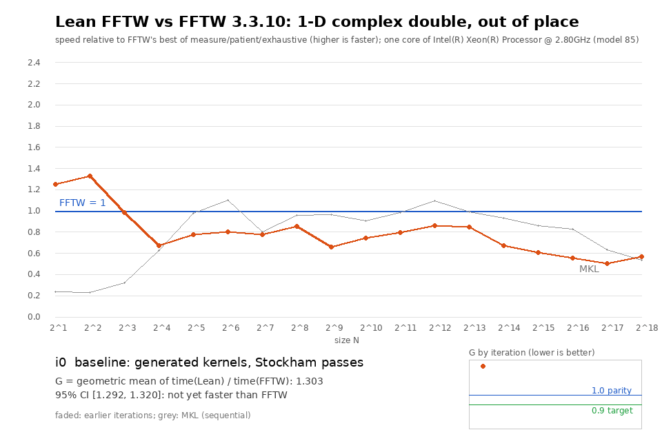

# Lean FFTW

A double-precision FFT library written in Lean 4, with kernel-checked proofs that what it
computes is the discrete Fourier transform. FFTW 3.3.10 is the benchmark competitor and the
source of the test harness; Lean FFTW never links or calls it.



## Results

* **Speed.** On the predeclared benchFFT workload (1-D complex, out of place, N = 2…2^18,
  one core), Lean FFTW takes **0.748×** the time of FFTW's best planner mode per size, as
  a geometric mean over the 18 sizes. The 95% CI is [0.739, 0.760], against a target of
  ≤ 0.90. Lean FFTW is faster than FFTW at 17 of the 18 sizes and at parity at N = 2^18.
  Most of the margin comes from small sizes; for N ≥ 1024 alone the ratio is 0.94. MKL
  is slower than both. Planning, which is not counted, is far slower than FFTW's: Lean
  FFTW measures every candidate plan, with no wisdom. Details:
  [docs/RESULTS.md](docs/RESULTS.md).
* **Accuracy.** libbench2's multiple-precision check gives an L2 error within 1.07× of
  FFTW's at every size.
* **Tests.** FFTW's own harness (libbench2 `--verify` driven by `tests/check.pl`) passes
  over FFTW's double-precision guru surface: complex, r2c/c2r and all 11 r2r kinds, any
  rank, vector rank and strides, in and out of place, split or interleaved. That covers
  all 50,702 problems of FFTW's exhaustive bigcheck enumeration (`check.pl -a`). See
  [docs/FFTW_INVENTORY.md](docs/FFTW_INVENTORY.md) for everything FFTW has and what is not
  covered (other precisions, threads, MPI, wisdom, the `fftw3.h` C API).
* **Proofs.** No `sorry`, no new axioms ([scripts/Axioms.lean](scripts/Axioms.lean)):
  * the spec agrees with Mathlib's `ZMod.dft`;
  * the generated butterfly kernels and the Stockham schedule compute the DFT exactly;
  * the executable binary64 reference is within an explicit bound of the exact DFT,
    through FloatLib's IEEE model.

  Details: [docs/THEOREMS.md](docs/THEOREMS.md).

## How the pieces fit

```
Lean spec (dftSum = Mathlib ZMod.dft)
   │ proved
Lean codelet generator ── butterflyK kernels ── Stockham schedule (stockhamWith)
   │ proved: exact DFT; binary64 error bound for refTransform
   │ prints
SIMD C kernels + C executor (fast engine, 1-D complex 2^k)
   │ tested bit for bit against refTransform (3,726 plans)
libbench2 / check.pl (FFTW's harness)
```

Everything outside the fast engine runs in the generic engine, which is pure Lean. Its
algorithm is proved correct in exact arithmetic but its floating-point execution is not
analysed. [docs/TRUST.md](docs/TRUST.md) lists every link and how it is established.

## Layout

| Path | Contents |
|---|---|
| `LeanFFTW/Spec` | the DFT specification |
| `LeanFFTW/Gen` | codelet generator (symbolic DFT, simplifier, CSE, vectorizer, C printer) |
| `LeanFFTW/Core` | generic engine (mixed radix, r2c/c2r, r2r, guru problems), twiddles |
| `LeanFFTW/Proof` | correctness and floating-point proofs |
| `csrc` | fast engine executor, generated kernels, Lean glue, differential test |
| `bench/backends` | libbench2 backends (Lean FFTW, MKL) |
| `tools` | protocol runner and analysis, accuracy, bigcheck, GIF |
| `results` | raw and analysed benchmark data |
| `docs` | contract, FFTW inventory, protocol, iteration log, results, theorems, trust |

## Building

Requirements: Lean 4.35.0 (`lean-toolchain`), the Mathlib and FloatLib revisions in
`lake-manifest.json`, gcc, and an AVX2 or AVX-512 x86-64 CPU for the fast engine.

```sh
lake build                                   # library and proofs
lake env lean scripts/Axioms.lean            # axiom audit
LEAN=<lean-4.35.0 dir> OUT=build FFTW_SRC=<fftw-3.3.10 tree> scripts/build.sh
ulimit -s unlimited; build/test_fast 14 18   # bit-exact differential test
build/bench-lean -s ocf1024                  # libbench2 speed run
```

`FFTW_SRC` is only needed for libbench2 (`libbench2.a`), FFTW's benchmark harness; leave it
unset to build only the library and the test. The generated kernels
(`csrc/lf_kernels_gen.c`) are committed; `lake env lean --run scripts/GenKernels.lean
csrc/lf_kernels_gen.c` regenerates them. The protocol runner is `tools/bench.py`
([docs/BENCHMARK_PROTOCOL.md](docs/BENCHMARK_PROTOCOL.md)).

## License

MIT ([LICENSE](LICENSE)). FFTW, libbench2 and MKL are not included.
