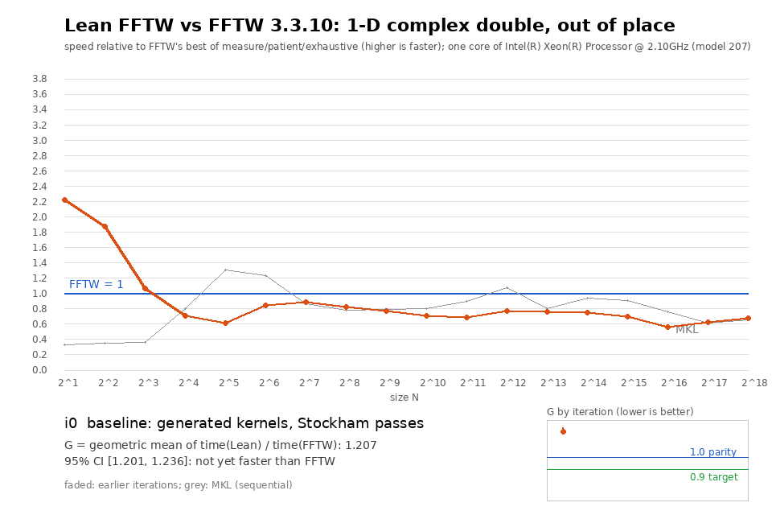
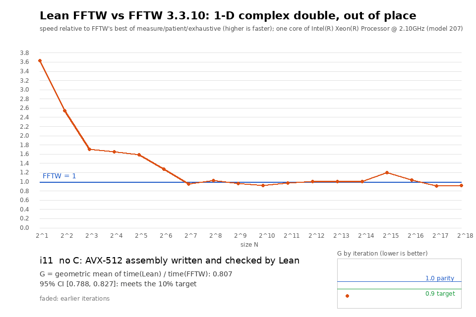

# Results

> **Two engines.** The latest run measures the assembly engine: the library is Lean plus
> AVX-512 assembly that Lean writes (`LeanFFTW/Asm`), with no C. Every run from Granite
> Rapids down used the C engine (`csrc/`, `tools/c/`), which was removed on 2026-11-10; those
> files are in the history up to commit `7cc9489`. The current state is in
> [TRUST.md](TRUST.md) and the README.

Runs of the predeclared protocol ([BENCHMARK_PROTOCOL.md](BENCHMARK_PROTOCOL.md)) are
reported below, newest first. The machine is a cloud VM whose CPU changed when the container
was re-provisioned (amendments 1, 3, 4, 5 and 6), so each run measures its iterations and
every competitor on one machine, and numbers are only compared within a run.

* **Latest: Emerald Rapids, i11 and i12, the assembly engine** (2026-11-10,
  [`results/emr-i12/`](../results/emr-i12), section below): **G(i12) = 0.750, CI [0.734,
  0.772]**; G(i11) = 0.807, CI [0.788, 0.827]. From N = 1024 up, i12 takes 0.90 of FFTW's
  time (i11: 1.00).
* Granite Rapids, i9 and i10 (2026-11-07, [`results/gnr-i10/`](../results/gnr-i10)):
  G(i10) = 0.814, CI [0.794, 0.829]. i10 is the Lean-driven round
  ([LEAN_DRIVEN.md](LEAN_DRIVEN.md)): planner in Lean, in-place address tables from Lean.
* Sapphire Rapids, i0–i9 (2026-10-31, [`results/spr-i9/`](../results/spr-i9)).
* Earlier: Sapphire Rapids, i0–i7 (2026-10-17, [`results/spr-i7/`](../results/spr-i7)).
* Earlier: Cascade Lake, i0–i6 (2026-10-17, [`results/clx-final/`](../results/clx-final)).
* **Independent reproduction of i9** (2026-11-04, [REPRODUCTION.md](REPRODUCTION.md),
  [`results/repro-2026-11-04/`](../results/repro-2026-11-04)): G = 0.828, CI [0.815, 0.853],
  against a freshly built FFTW with regenerated wisdom. The small-size margin reproduces.
  The N ≥ 1024 win reported below does not: the rerun measures 1.03 there.

A run of i0–i8 on 2026-10-31 ([`results/spr-i8/`](../results/spr-i8)) found the code
placement regression that i9 fixes (see ITERATIONS.md) and is kept for the record.

**A note on CPU names.** The runs labelled "Sapphire Rapids" and the run labelled "Emerald
Rapids" report the same processor to `lscpu`: family 6, model 207, stepping 2, 2.1 GHz,
260 MB of third-level cache (`meta.json` of each run). Model 207 is Emerald Rapids, so the
"Sapphire Rapids" label of the earlier runs was most likely wrong. The directory names and
the text of those runs are left as written. They are still different virtual machines on
different days, and numbers are compared within a run only.

The first GIF is the history of the C engine (i0–i9, 2026-10-31). The second is the assembly
engine in the latest run (i11 and i12).

## Latest run: Emerald Rapids, i11 and i12 (the assembly engine)

Emerald Rapids (family 6 model 207, 2.1 GHz, 4 vCPUs, KVM), 2026-11-10 (amendment 6). FFTW
3.3.10 with wisdom generated from scratch on this machine for each planner mode (MEASURE,
PATIENT, EXHAUSTIVE), then 10 interleaved process runs per (implementation, size), pinned to
CPU 0: 900 runs, none failed. MKL is not installed on this machine.

* i11 is the first state without C (commit `79069f3`): the engine is assembly written,
  checked and planned by Lean. i12 (commit `07722b7`) adds the allocator that chooses
  instruction orders by the micro-operation counts of the proved cost model
  ([COST_MODEL.md](COST_MODEL.md)) and the in-place schedule for sizes that are not powers
  of two. The C-engine binaries (i0–i10) no longer build from the repository and are not in
  this run.
* **G(i12 / FFTW best mode) = 0.750, 95% CI [0.734, 0.772]**; against each mode: MEASURE
  0.662, PATIENT 0.706, EXHAUSTIVE 0.726. The predeclared target (upper bound ≤ 0.90) is met
  by a library with no C in it.
* G(i11 / FFTW best mode) = 0.807, CI [0.788, 0.827].
* **i12 / i11 = 0.929, CI [0.910, 0.957].** The quick measurement behind
  COST_MODEL.md had given 0.927 for the allocator change.
* By size band (geometric mean of i12 / FFTW best): 0.43 for N ≤ 16, 0.84 for N = 32 … 512,
  **0.90 for N ≥ 1024** (i11: 1.00). In the C-engine runs the large sizes were at parity or
  behind FFTW (0.93 to 1.11 in the runs on this CPU model).
* **Where FFTW is still ahead:** N = 128 (1.03), N = 2^17 (1.17) and N = 2^18 (1.08).

| N | FFTW best | mode | i11 | i12 | i11 / FFTW | i12 / FFTW |
|---:|---:|---|---:|---:|---:|---:|
| 2 | 3.65 ns | measure | 1.01 ns | 0.99 ns | 0.28 | 0.27 |
| 4 | 4.05 ns | measure | 1.59 ns | 1.61 ns | 0.39 | 0.40 |
| 8 | 5.64 ns | patient | 3.30 ns | 3.01 ns | 0.59 | 0.53 |
| 16 | 12.23 ns | patient | 7.41 ns | 7.25 ns | 0.61 | 0.59 |
| 32 | 27.57 ns | exhaustive | 17.42 ns | 17.17 ns | 0.63 | 0.62 |
| 64 | 51.95 ns | patient | 40.68 ns | 40.40 ns | 0.78 | 0.78 |
| 128 | 93.41 ns | measure | 97.92 ns | 96.16 ns | 1.05 | 1.03 |
| 256 | 226.30 ns | exhaustive | 221.33 ns | 217.13 ns | 0.98 | 0.96 |
| 512 | 496.27 ns | patient | 512.84 ns | 420.90 ns | 1.03 | 0.85 |
| 1024 | 1.10 µs | exhaustive | 1.20 µs | 1.07 µs | 1.09 | 0.98 |
| 2048 | 2.73 µs | exhaustive | 2.81 µs | 2.40 µs | 1.03 | 0.88 |
| 4096 | 7.83 µs | exhaustive | 7.78 µs | 6.20 µs | 0.99 | 0.79 |
| 8192 | 15.19 µs | exhaustive | 15.11 µs | 12.92 µs | 0.99 | 0.85 |
| 16384 | 36.89 µs | exhaustive | 36.62 µs | 29.49 µs | 0.99 | 0.80 |
| 32768 | 89.06 µs | exhaustive | 74.40 µs | 70.27 µs | 0.84 | 0.79 |
| 65536 | 237.21 µs | exhaustive | 228.10 µs | 208.33 µs | 0.96 | 0.88 |
| 131072 | 552.17 µs | exhaustive | 604.29 µs | 647.66 µs | 1.09 | 1.17 |
| 262144 | 1.255 ms | exhaustive | 1.365 ms | 1.355 ms | 1.09 | 1.08 |

Times are medians of the 10 runs.

**The two largest sizes.** At 2^17 the ten i12 runs range from 540 to 757 µs and FFTW's from
504 to 615 µs; at 2^18, 1.03 to 1.68 ms against 1.14 to 1.37 ms. Each Lean FFTW process plans
again by measurement, and at these sizes (4 to 8 MB of data, beyond the 2 MB second-level
cache) the leading plans differ by less than the machine's noise, so each process picks a
different one. Eight more processes at 2^17, each followed by FFTW, gave ratios from 0.94 to
1.23 with median 1.00 ([`n131072-reruns.txt`](../results/emr-i12/n131072-reruns.txt), not a
protocol measurement). So the best plans are as fast as FFTW's, the planner does not find
them reliably, and the protocol's medians (1.17 and 1.08) are what a user gets today. FFTW
does not have this problem in the protocol because its plan comes from wisdom. Lean FFTW has
no wisdom yet.

**Planning time** (not part of the metric): median 1.5 s at 2^16, 3.8 s at 2^17, 8.8 s at
2^18. FFTW with wisdom plans in milliseconds.

**Correctness and accuracy of the benchmarked build.**

* libbench2 `--verify` passes at all 18 sizes for both binaries
  ([`verify.txt`](../results/emr-i12/verify.txt)).
* Accuracy (libbench2 `--accuracy`, 10 rounds): the forward L2 error of i12 is between 0.85×
  and 1.05× FFTW PATIENT's at every size (protocol limit: 2×).
* FFTW's exhaustive bigcheck on the i12 library: 50,702 of 50,702 problems pass and 30 of 30
  unsupported problems are rejected ([`results/bigcheck-i12/`](../results/bigcheck-i12)).
  This is the first full run on the assembly engine.
* `asm_test` compares the engine bit for bit with `refTransform`: 596 plans of the small
  transforms, 6,956 runs of Stockham and blocked plans, 1,380 plans at 345 sizes whose prime
  factors are at most 13, and 17,024 plans of the powers of two up to 2^11; no mismatch.

**Not protocol runs** (same machine, [`results/emr-quick/`](../results/emr-quick), minimum
of 3 to 5 interleaved rounds, FFTW in patient mode):

* Ten sizes that are not powers of two, 360 to 50000: 0.73–1.04 of FFTW's time, geometric
  mean 0.89 (before the in-place schedule covered them: 1.07).
* Threads (4 virtual CPUs, FFTW built with `--enable-threads`, wisdom per thread count,
  N = 4096 to 2^18): 0.52–0.72 of FFTW's time at 2 threads, 0.28–0.77 at 4. The engine's own
  gain from 1 to 4 threads is 2.6–2.9× at 2^16 and 2^18 and under 1.2× at 16384 and below.
* No GPU is available on these machines; nothing was built or measured for one.

## Run of 2026-11-07: Granite Rapids, i9 and i10

Granite Rapids (family 6 model 173, 2.3 GHz, 4 vCPUs, KVM). FFTW 3.3.10 with wisdom generated
from scratch on this CPU for each planner mode (MEASURE, PATIENT, EXHAUSTIVE), then 10
interleaved process runs per (implementation, size), pinned to CPU 0 (amendment 5). MKL is not
installed on this machine.

* **G(i10 / FFTW best mode) = 0.814, 95% CI [0.794, 0.829]**; against each mode: MEASURE
  0.740, PATIENT 0.801, EXHAUSTIVE 0.791.
* **i10 / i9 = 0.990, CI [0.963, 1.008]**: the Lean planner (race ordered and pruned by the
  proved operation counts) picks plans as fast as the exhaustive C-era search.
* Per size (i10 / FFTW best): 0.28, 0.32, 0.48, 0.57, 0.58, 0.75, 0.88 for N = 2 … 128;
  0.96 at 256, 1.22 at 512, 0.96–1.08 from 1024 to 32768, 1.12 at 65536, 1.34 at 2^17 and
  1.31 at 2^18. The large-size gap is larger on this CPU than on Sapphire Rapids.
* libbench2 `--verify` passes at all 18 sizes. Accuracy (libbench2 `--accuracy`, 10 rounds): Lean FFTW's forward L2 error is within 1.05× of FFTW PATIENT's at every
  size. FFTW's exhaustive bigcheck on the i10 binary: 50,702 of 50,702 problems pass and 30 of
  30 unsupported problems are rejected.

## Run of 2026-10-31: Sapphire Rapids, i0–i9

### Setup

As in the earlier Sapphire Rapids run below: the same CPU model (family 6 model 207,
2.1 GHz, 4 vCPUs, AVX-512), every process pinned to CPU 0, one thread, workload `ocf<N>`
for N = 2…2^18, 14 implementations × 18 sizes × 10 process runs in shuffled order (2,520
runs, all exit 0), median over runs of libbench2's minimum of 8 timings. FFTW used the
wisdom generated per mode on this CPU model for the i7 run (amendment 4).

### Primary result

**G = time(Lean FFTW i9) / time(FFTW, best mode per size), geometric mean over the 18
sizes: 0.750, 95% bootstrap CI [0.744, 0.765].** The success criterion (upper end of the
CI ≤ 0.90) is met. Geometric-mean times: Lean FFTW i9 0.91 µs, FFTW best mode 1.22 µs,
MKL 1.63 µs.

| N | Lean i9 | FFTW best | ratio | | N | Lean i9 | FFTW best | ratio |
|---|---|---|---|---|---|---|---|---|
| 2 | 1.77 ns | 6.27 ns | 0.28 | | 1024 | 1.16 µs | 1.20 µs | 0.97 |
| 4 | 2.12 ns | 6.70 ns | 0.32 | | 2048 | 2.81 µs | 3.19 µs | 0.88 |
| 8 | 3.64 ns | 7.47 ns | 0.49 | | 4096 | 7.73 µs | 8.17 µs | 0.95 |
| 16 | 8.00 ns | 14.7 ns | 0.54 | | 8192 | 17.0 µs | 17.1 µs | 1.00 |
| 32 | 19.5 ns | 31.9 ns | 0.61 | | 16384 | 38.1 µs | 38.1 µs | 1.00 |
| 64 | 43.3 ns | 59.1 ns | 0.73 | | 32768 | 78.9 µs | 95.3 µs | 0.83 |
| 128 | 97.5 ns | 109 ns | 0.89 | | 65536 | 225 µs | 212 µs | 1.06 |
| 256 | 224 ns | 222 ns | 1.01 | | 131072 | 526 µs | 580 µs | 0.91 |
| 512 | 502 ns | 451 ns | **1.11** | | 262144 | 1.22 ms | 1.47 ms | 0.83 |

For N ≥ 1024 alone the geometric-mean ratio is **0.93**: in this run Lean FFTW is
faster than FFTW at large sizes too, unlike in the i7 run of 2026-10-17 (1.11). The power-of-two
code did not change between i7 and i9, and i7 measures 0.91 for N ≥ 1024 in this run, so
the difference between the two runs is the machine, not the code. The clearest remaining loss is N = 512 (1.11).

### By iteration

G against FFTW's best mode, from the same run:

| Iteration | G | 95% CI | N ≥ 1024 only |
|---|---|---|---|
| i0 baseline | 1.207 | [1.201, 1.236] | 1.446 |
| i1 fused small transforms, in-place schedule | 0.955 | [0.949, 0.976] | 0.971 |
| i2 FMA contraction | 0.963 | [0.956, 0.982] | 0.973 |
| i3 interleaved kernels for small N | 0.859 | [0.852, 0.876] | 0.981 |
| i4 measuring planner, cache blocking | 0.833 | [0.828, 0.851] | 0.927 |
| i5 two-pass interleaved kernels, vectorizer | 0.808 | [0.800, 0.825] | 0.936 |
| i6 direct kernel dispatch, planning on the real arrays | 0.759 | [0.753, 0.773] | 0.928 |
| i7 proved tan-factored twiddles | 0.736 | [0.731, 0.752] | 0.910 |
| i8 proved radix 3–15 kernels, odd sizes in the fast engine | 0.777 | [0.770, 0.792] | 0.934 |
| **i9** 64-byte code alignment | **0.750** | **[0.744, 0.765]** | **0.932** |
| *for reference:* MKL | 1.345 | [1.337, 1.371] | 1.222 |
| FFTW MEASURE only | 1.093 | [1.085, 1.117] | 1.140 |
| FFTW PATIENT only | 1.012 | [1.001, 1.032] | 1.008 |
| FFTW EXHAUSTIVE only | 1.046 | [1.039, 1.068] | 1.044 |

i8 and i9 change nothing for powers of two except code layout, so the primary workload
was not expected to move. It moved twice anyway. i8 was 0.7 ns slower than i7 at N = 2 and 4
(2.47 vs 1.74 ns at N = 2) with byte-identical kernels and dispatch code at different
addresses; i9 aligns functions and loops to 64 bytes and gets those sizes back. **i9 is
still 2% slower than i7 overall (i9/i7 = 1.020, CI [1.003, 1.032])**, mostly at N = 8
(3.64 vs 3.38 ns), which is again a code-placement effect of a fraction of a nanosecond.
So the best primary-workload result in this run is i7's 0.736, and i9's 0.750 is the
current library.

Planning time (medians, not part of G): Lean FFTW 0.015 s at N = 2, 0.35 s at N = 1024
and 22 s at N = 2^18; FFTW from wisdom a few ms or less.

### Accuracy

libbench2 `--accuracy` (10 random inputs per size), forward relative L2 error, measured on
the i8 binary (i9 has the same kernels and plans, compiled with different alignment).
Data: [`results/spr-i9/accuracy.json`](../results/spr-i9/accuracy.json).

| N | Lean i8/i9 | FFTW (measure / patient / exhaustive) |
|---|---|---|
| 8 | 6.3e-17 | 7.1e-17 / 7.1e-17 / 7.1e-17 |
| 64 | 1.2e-16 | 1.4e-16 / 1.4e-16 / 1.4e-16 |
| 1024 | 1.9e-16 | 1.9e-16 / 1.8e-16 / 1.8e-16 |
| 16384 | 2.3e-16 | 2.2e-16 / 2.3e-16 / 2.3e-16 |
| 262144 | 2.8e-16 | 2.7e-16 / 2.8e-16 / 2.8e-16 |

At every size the error is at most 1.08× the lowest of the three FFTW modes (worst at
N = 8192); the protocol's limit is 2×.

### Non-power-of-two sizes (now in the fast engine)

Secondary workload, `ocf<N>` for N = 6, 15, 80, 210, 1000, 4725, 10368: 5 process runs
each, same method, now against all three FFTW modes
([`results/spr-nonpow2-i9/`](../results/spr-nonpow2-i9)). In i7 these sizes ran in the
pure-Lean generic engine; in i9 they run in the C fast engine with the proved radix-3–15
kernels.

| N | Lean i7 | Lean i9 | FFTW MEASURE | PATIENT | EXHAUSTIVE | i9 / FFTW best |
|---|---|---|---|---|---|---|
| 6 | 2.81 µs | 2.87 ns | 6.46 ns | 6.68 ns | 6.69 ns | 0.44 |
| 15 | 6.30 µs | 12.7 ns | 17.1 ns | 16.9 ns | 17.1 ns | 0.75 |
| 80 | 39.8 µs | 91.5 ns | 64.4 ns | 64.7 ns | 69.7 ns | **1.42** |
| 210 | 96.3 µs | 379 ns | 368 ns | 385 ns | 349 ns | 1.08 |
| 1000 | 505 µs | 1.56 µs | 1.59 µs | 1.45 µs | 1.34 µs | 1.16 |
| 4725 | 2.50 ms | 19.3 µs | 17.2 µs | 17.4 µs | 16.7 µs | 1.16 |
| 10368 | 6.98 ms | 23.4 µs | 24.4 µs | 19.9 µs | 22.5 µs | 1.18 |

**G(i9 / FFTW best mode) = 0.971, 95% CI [0.950, 1.043]**: parity on this workload,
where i7 was about 300× slower than FFTW. i9 is 360× faster than i7 here (geometric mean).
Against FFTW MEASURE alone, G = 0.908 [0.829, 0.963]. Lean FFTW wins at the sizes that
are single generated kernels (6, 15) and loses by 8–18% at the multi-pass sizes, most at
N = 80 (1.42). Accuracy at these sizes is within 1.11× of FFTW
([`accuracy.json`](../results/spr-nonpow2-i9/accuracy.json)).

### Correctness of the benchmarked build (i9)

* Differential test, bit for bit against `refTransform`: `test_fast 14 18` (every plan of
  every power of two to 2^14, blocked plans to 2^18), 3,726 plans, 0 mismatches; `test_fast
  mixed 300 1000 3000 4725 7203 10368` (every plan of every 13-smooth size to 300 that is
  not a power of two, plus the listed sizes), 6,496 plans, 0 mismatches. Both on the i8
  kernels, which i9 compiles unchanged; i9 itself was re-checked with `test_fast 12` and
  `test_fast mixed 64 1000` (2,422 plans, 0 mismatches).
* libbench2 `--verify` for `ocf`, `icf`, `ocb`, `icb` at 15 non-power-of-two sizes from 6
  to 10368 (60 problems) on i9: all pass.
* FFTW's bigcheck enumeration (`check.pl -a`) on i9: 50,702 of 50,702 problems pass
  `--verify`, and all 30 problems that must be rejected are rejected
  ([`results/bigcheck-i9/`](../results/bigcheck-i9)).

## Earlier run: Sapphire Rapids, i0–i7

### Setup

* Machine: KVM guest, Intel Xeon @ 2.10 GHz (family 6 model 207, Sapphire Rapids),
  4 vCPUs, AVX-512, L2 2 MiB per core. Linux 6.18, gcc 13.3.
* Everything else as in the earlier run: every process pinned to CPU 0, one thread,
  workload `ocf<N>` for N = 2…2^18, 12 implementations × 18 sizes × 10 process runs in
  shuffled order (2,160 runs, all exit 0), median over runs of libbench2's minimum of 8
  timings. FFTW wisdom was generated from scratch on this CPU for each mode.

### Primary result

**G = time(Lean FFTW i7) / time(FFTW, best mode per size), geometric mean over the 18
sizes: 0.809, 95% bootstrap CI [0.795, 0.868].** The success criterion (upper end of the
CI ≤ 0.90) is met on this CPU too. Geometric-mean times: Lean FFTW i7 0.93 µs, FFTW best
mode 1.15 µs, MKL 1.63 µs. Against the per-size best of all four competitor
configurations, G = 0.819.

| N | Lean i7 | FFTW best | ratio | | N | Lean i7 | FFTW best | ratio |
|---|---|---|---|---|---|---|---|---|
| 2 | 1.47 ns | 5.64 ns | 0.26 | | 1024 | 1.22 µs | 1.18 µs | 1.04 |
| 4 | 1.7 ns | 5.7 ns | 0.30 | | 2048 | 2.95 µs | 2.77 µs | 1.07 |
| 8 | 3.04 ns | 6.32 ns | 0.48 | | 4096 | 8.34 µs | 7.26 µs | 1.15 |
| 16 | 6.04 ns | 12.8 ns | 0.47 | | 8192 | 18.6 µs | 17 µs | 1.09 |
| 32 | 17.8 ns | 29.6 ns | 0.60 | | 16384 | 40.6 µs | 36.9 µs | 1.10 |
| 64 | 41.2 ns | 51.7 ns | 0.80 | | 32768 | 86.9 µs | 91.9 µs | 0.95 |
| 128 | 95.1 ns | 106 ns | 0.90 | | 65536 | 279 µs | 236 µs | 1.19 |
| 256 | 232 ns | 228 ns | 1.02 | | 131072 | 805 µs | 590 µs | 1.36 |
| 512 | 524 ns | 482 ns | 1.09 | | 262144 | 1.61 ms | 1.44 ms | 1.12 |

The whole margin comes from small sizes. On this CPU Lean FFTW is faster than FFTW for
N ≤ 128 and slower from N = 256 on, except at N = 32768. **For N ≥ 1024 alone the
geometric-mean ratio is 1.11, so FFTW is 11% faster there.** On Cascade Lake the same
ratio was 0.94. At N ≥ 2^15 a fixed plan's time varies by ±20% between processes on this
VM, so those per-size ratios are the least certain.

### By iteration

G against FFTW's best mode, from the same run:

| Iteration | G | 95% CI | N ≥ 1024 only |
|---|---|---|---|
| i0 baseline | 1.263 | [1.249, 1.362] | 1.526 |
| i1 fused small transforms, in-place schedule | 1.032 | [1.012, 1.110] | 1.134 |
| i2 FMA contraction | 1.032 | [1.012, 1.103] | 1.147 |
| i3 interleaved kernels for small N | 0.951 | [0.935, 1.034] | 1.098 |
| i4 measuring planner, cache blocking | 0.941 | [0.919, 1.005] | 1.124 |
| i5 two-pass interleaved kernels, vectorizer | 0.896 | [0.876, 0.965] | 1.124 |
| i6 direct kernel dispatch, planning on the real arrays | 0.818 | [0.801, 0.876] | 1.102 |
| **i7** proved tan-factored twiddles | **0.809** | **[0.795, 0.868]** | **1.113** |
| *for reference:* MKL | 1.417 | [1.396, 1.523] | 1.304 |
| FFTW MEASURE only | 1.133 | [1.115, 1.218] | 1.189 |
| FFTW PATIENT only | 1.026 | [1.011, 1.115] | 1.025 |
| FFTW EXHAUSTIVE only | 1.067 | [1.033, 1.145] | 1.079 |

i7 against i6 directly: G = 0.990, 95% CI [0.949, 1.037]. The kernel change removes 5% of
the operations of the radix-16 kernels and 9% of the radix-32 kernels, but it makes no
difference to the benchmark that this run can detect. The planner mostly picks radix 4
and 8 passes, which did not change, and the sizes where radix 16/32 are used are the
memory-bound ones. See i7 in [ITERATIONS.md](ITERATIONS.md).

Planning time (medians, not part of G): Lean FFTW 0.013 s at N = 2, 0.34 s at N = 1024 and
25 s at N = 2^18; FFTW from wisdom 2.5 ms or less.

### Accuracy

libbench2 `--accuracy` (10 random inputs per size), forward relative L2 error. Data:
[`results/spr-i7/accuracy.json`](../results/spr-i7/accuracy.json).

| N | Lean i7 | FFTW (measure / patient / exhaustive) | MKL |
|---|---|---|---|
| 8 | 6.2e-17 | 7.0e-17 / 7.0e-17 / 7.0e-17 | 5.6e-17 |
| 64 | 1.2e-16 | 1.4e-16 / 1.4e-16 / 1.4e-16 | 1.2e-16 |
| 1024 | 1.8e-16 | 1.9e-16 / 1.8e-16 / 1.8e-16 | 1.8e-16 |
| 16384 | 2.3e-16 | 2.2e-16 / 2.3e-16 / 2.3e-16 | 2.3e-16 |
| 262144 | 2.6e-16 | 2.7e-16 / 2.7e-16 / 2.8e-16 | 3.7e-16 |

At every size, the error of the i7 kernels is at most 1.08× the lowest of the three FFTW
modes (worst at N = 4096); the protocol's limit is 2×. N = 2 and 4 are exact or nearly so
for all implementations.

### Non-power-of-two sizes (generic engine)

Secondary workload, `ocf<N>` for N = 6, 15, 80, 210, 1000, 4725, 10368: 5 process runs
each, same method ([`results/spr-nonpow2/`](../results/spr-nonpow2)). These sizes run in
the pure-Lean generic engine. In i7 its compiled code is the `@[csimp]` fast executor
(`execFloat_eq_fast`).

| N | Lean i6 | Lean i7 | FFTW MEASURE | i7 / FFTW |
|---|---|---|---|---|
| 6 | 5.1 µs | 3.1 µs | 6.35 ns | 490 |
| 15 | 15.2 µs | 5.87 µs | 20.0 ns | 290 |
| 80 | 122 µs | 43.8 µs | 78.9 ns | 550 |
| 210 | 320 µs | 117 µs | 408 ns | 290 |
| 1000 | 2.43 ms | 505 µs | 1.84 µs | 270 |
| 4725 | 9.98 ms | 3.03 ms | 20.2 µs | 150 |
| 10368 | 22.9 ms | 8.58 ms | 25.7 µs | 330 |

i7 is 2.8× faster than i6 on these sizes (geometric mean; CI [2.5, 3.2]). It is still
about 300× slower than FFTW, because the generic engine evaluates each Cooley–Tukey step
as a full sum (`O(n · Σ factors)` complex multiply-adds) in scalar Lean. Making these
sizes fast means running them through the C engine with generated radix-3/5/7 kernels,
which has not been done.

### Correctness of the benchmarked build

* Differential test against the Lean reference (`test_fast 14 18`): 3,726 plans, 0
  mismatches.
* libbench2 `--verify`: `ocf` at all 18 primary sizes and `icf`, `ocb`, `icb` at 9 of
  them pass.
* FFTW's bigcheck enumeration (`check.pl -a`) on the i7 library: 50,702 of 50,702
  problems pass `--verify`, and all 30 problems that must be rejected are rejected
  ([`results/bigcheck-i7/`](../results/bigcheck-i7)). With the `@[csimp]` executor the
  whole enumeration took 17 minutes on 4 cores; with i6 it took about an hour.

## Earlier run: Cascade Lake (i0–i6)

Data: [`results/clx-final/`](../results/clx-final). GIF:
[`results/optimization-clx.gif`](../results/optimization-clx.gif).

### Setup

* Machine: KVM guest, Intel Xeon @ 2.80 GHz (family 6 model 85, Cascade Lake), 4 vCPUs,
  AVX-512, L2 1 MiB per core, L3 33 MiB shared. Linux 6.18, gcc 13.3.
* Every process pinned to CPU 0 (`taskset -c 0`); one thread everywhere; nothing else
  heavy ran during the run.
* Workload: `ocf<N>`: 1-D complex double, forward, out of place, N = 2…2^18 (18 sizes).
* 11 implementations × 18 sizes × 10 process runs, in an order shuffled per round
  (1,980 runs, all exit 0). libbench2 reports the minimum of 8 timings per process run;
  the statistic per size is the median over the 10 runs.
* Competitors: FFTW 3.3.10 (built from source with SSE2/AVX/AVX2/AVX-512/FMA; MEASURE,
  PATIENT and EXHAUSTIVE, wisdom generated on this CPU) and Intel MKL 2026.2
  (sequential). The Lean FFTW iterations i0–i6 are the binaries recorded in
  [ITERATIONS.md](ITERATIONS.md).

### Primary result

**G = time(Lean FFTW i6) / time(FFTW, best mode per size), geometric mean over the 18
sizes: 0.748, 95% bootstrap CI [0.739, 0.760].** The success criterion (upper end of the
CI ≤ 0.90) is met. FFTW is the strongest competitor (geometric-mean time: FFTW best mode
1.74 µs, MKL 2.46 µs; Lean FFTW i6 1.30 µs). Against the per-size best of all four
competitor configurations, G = 0.755 [0.747, 0.768].

| N | Lean i6 | FFTW best | ratio | | N | Lean i6 | FFTW best | ratio |
|---|---|---|---|---|---|---|---|---|
| 2 | 2.73 ns | 6.08 ns | 0.45 | | 1024 | 1.83 µs | 1.94 µs | 0.94 |
| 4 | 3.33 ns | 7.28 ns | 0.46 | | 2048 | 4.32 µs | 4.73 µs | 0.91 |
| 8 | 5.29 ns | 11.4 ns | 0.46 | | 4096 | 10.0 µs | 11.3 µs | 0.89 |
| 16 | 11.5 ns | 21.2 ns | 0.54 | | 8192 | 22.6 µs | 25.5 µs | 0.89 |
| 32 | 25.0 ns | 48.9 ns | 0.51 | | 16384 | 49.8 µs | 54.5 µs | 0.91 |
| 64 | 51.3 ns | 84.4 ns | 0.61 | | 32768 | 135 µs | 137 µs | 0.98 |
| 128 | 119 ns | 158 ns | 0.75 | | 65536 | 325 µs | 338 µs | 0.96 |
| 256 | 272 ns | 340 ns | 0.80 | | 131072 | 761 µs | 801 µs | 0.95 |
| 512 | 737 ns | 749 ns | 0.98 | | 262144 | 2.21 ms | 2.20 ms | **1.01** |

How the margin is distributed: most of it comes from N ≤ 256, where whole transforms
are single generated kernels. For N ≥ 1024 alone, the geometric-mean ratio is 0.94.
N = 2^18 is at parity (1.01; Lean FFTW is slower there by 0.7%). At N ≥ 2^15 a single
plan's time varies by ±20% between processes on this machine (see i6 in
ITERATIONS.md), so those per-size ratios are the least certain.

### By iteration

G against FFTW's best mode, from the same run:

| Iteration | G | 95% CI | N ≥ 1024 only |
|---|---|---|---|
| i0 baseline | 1.303 | [1.292, 1.320] | 1.486 |
| i1 fused small transforms, in-place schedule | 0.950 | [0.942, 0.965] | 0.988 |
| i2 FMA contraction | 0.963 | [0.952, 0.973] | 0.997 |
| i3 interleaved kernels for small N | 0.883 | [0.875, 0.896] | 0.985 |
| i4 measuring planner, cache blocking | 0.853 | [0.846, 0.864] | 0.954 |
| i5 two-pass interleaved kernels, vectorizer | 0.832 | [0.821, 0.853] | 0.960 |
| **i6** direct kernel dispatch, planning on the real arrays | **0.748** | **[0.739, 0.760]** | **0.938** |
| *for reference:* MKL | 1.414 | [1.401, 1.433] | 1.183 |
| FFTW MEASURE only | 1.076 | [1.069, 1.086] | 1.129 |
| FFTW PATIENT only | 1.027 | [1.016, 1.038] | 1.035 |
| FFTW EXHAUSTIVE only | 1.012 | [1.003, 1.023] | 1.020 |

i2 is slightly slower than i1 on this CPU; it was tuned on the earlier machine (see
the hardware note in ITERATIONS.md). The baseline measured on that earlier machine
(Sapphire Rapids, [`results/i0-baseline`](../results/i0-baseline)) was G = 1.252
[1.248, 1.267].

Planning time is reported separately, as the protocol requires, and is not part of G.
Lean FFTW has no wisdom: its planner measures every candidate plan on every run, which
takes 0.014 s at N = 2, 0.35 s at N = 1024 and about 40 s at N = 2^18 (medians). FFTW
planned from wisdom it had accumulated on this CPU, which takes 5 µs to 9 ms. So Lean FFTW
is far more expensive to plan, which matters for programs that plan often.

### Accuracy

libbench2 `--accuracy` (10 random inputs per size, against libbench2's
multiple-precision FFT), forward relative L2 error. Data:
[`results/clx-final/accuracy.json`](../results/clx-final/accuracy.json).

| N | Lean i6 | FFTW (measure / patient / exhaustive) | MKL |
|---|---|---|---|
| 8 | 6.3e-17 | 7.1e-17 / 7.1e-17 / 7.1e-17 | 5.6e-17 |
| 64 | 1.2e-16 | 1.3e-16 / 1.3e-16 / 1.2e-16 | 1.2e-16 |
| 1024 | 1.8e-16 | 1.9e-16 / 1.8e-16 / 1.9e-16 | 1.8e-16 |
| 16384 | 2.3e-16 | 2.2e-16 / 2.2e-16 / 2.3e-16 | 2.3e-16 |
| 262144 | 2.8e-16 | 2.8e-16 / 2.7e-16 / 2.7e-16 | 3.7e-16 |

At every one of the 18 sizes, Lean FFTW's error is at most 1.07× the lowest of the three
FFTW modes; the protocol's limit is 2×. N = 2 and 4 are exact or nearly so for all
implementations.

### Correctness of the benchmarked builds

* Differential test, bit for bit against the Lean reference `refTransform`
  (`csrc/test_fast.c`, `test_fast 14 18`): 3,726 plans, 0 mismatches.
* libbench2 `--verify` for `ocf`, `icf`, `ocb`, `icb` at N = 1…2^18: 76 of 76 pass.
* FFTW's `check.pl` (random problems over the guru interface): 434 of 434 pass.
* FFTW's bigcheck enumeration (`check.pl -a`), on the final library: 50,702 of 50,702
  problems pass `--verify`, and all 30 problems that must be rejected are rejected.

The library after the benchmark differs from i6 only in the generic engine. Bigcheck
found that empty vector dimensions (`n = 0`) were rejected, and FFTW accepts them as empty
problems. The fix does not touch the fast engine's code or the benchmarked path.
